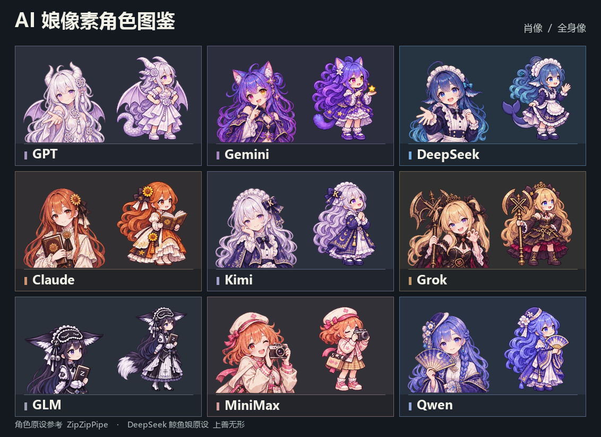
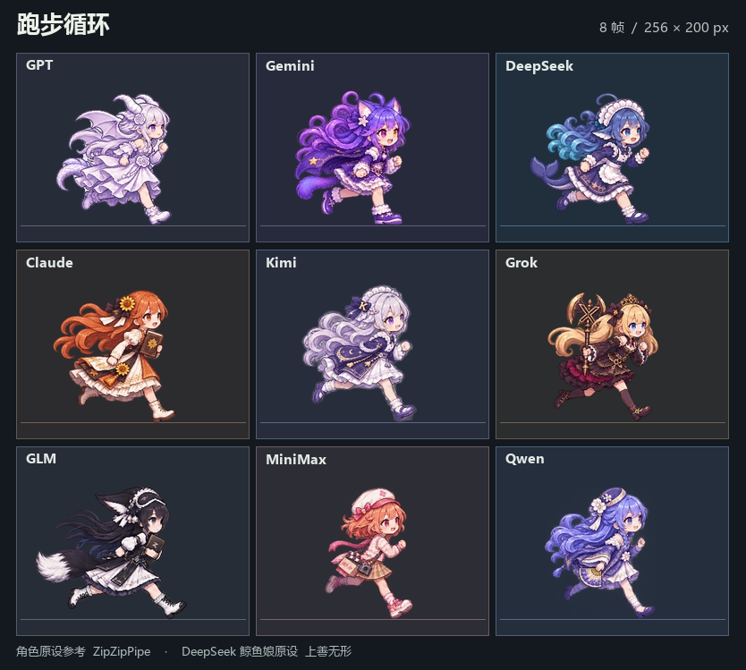

# AI 娘像素素材库

《六级翻译智能背记》的九位旅伴，共 76 张透明 WebP。包含头像、立绘、跑步循环、划船和乘车动作，也收录了 GPT 开箱、Gemini 弓背蓄势、DeepSeek 投掷 Q 版分身等游戏专用画面。

**[打开在线素材库](https://waiteddegree608-ship-it.github.io/ai-girls-pixel-assets/)** · **[下载全量 ZIP](https://github.com/waiteddegree608-ship-it/ai-girls-pixel-assets/releases/latest/download/ai-girls-pixel-assets.zip)** · [署名与使用条件](CREDITS.md)

## 按角色下载

选择角色可以预览动作、暂停动画、查看整张原图，也可以只下载一张 WebP。每个 ZIP 都包含该角色的图片、标记了帧布局的 `catalog.json` 和署名说明。

| 角色 | 预览 | 下载 |
| --- | --- | --- |
| GPT | [开箱](https://waiteddegree608-ship-it.github.io/ai-girls-pixel-assets/#gpt/chest) | [GPT.zip](https://github.com/waiteddegree608-ship-it/ai-girls-pixel-assets/releases/latest/download/gpt.zip) |
| DeepSeek | [投掷分身](https://waiteddegree608-ship-it.github.io/ai-girls-pixel-assets/#deepseek/thrown-doll) | [DeepSeek.zip](https://github.com/waiteddegree608-ship-it/ai-girls-pixel-assets/releases/latest/download/deepseek.zip) |
| Gemini | [弓背蓄势](https://waiteddegree608-ship-it.github.io/ai-girls-pixel-assets/#gemini/arched-back) | [Gemini.zip](https://github.com/waiteddegree608-ship-it/ai-girls-pixel-assets/releases/latest/download/gemini.zip) |
| Claude | [首领姿态](https://waiteddegree608-ship-it.github.io/ai-girls-pixel-assets/#claude/battle) | [Claude.zip](https://github.com/waiteddegree608-ship-it/ai-girls-pixel-assets/releases/latest/download/claude.zip) |
| Grok | [立绘](https://waiteddegree608-ship-it.github.io/ai-girls-pixel-assets/#grok/standing) | [Grok.zip](https://github.com/waiteddegree608-ship-it/ai-girls-pixel-assets/releases/latest/download/grok.zip) |
| GLM | [跑步](https://waiteddegree608-ship-it.github.io/ai-girls-pixel-assets/#glm/run) | [GLM.zip](https://github.com/waiteddegree608-ship-it/ai-girls-pixel-assets/releases/latest/download/glm.zip) |
| Kimi | [划船与乘车](https://waiteddegree608-ship-it.github.io/ai-girls-pixel-assets/#kimi/seated) | [Kimi.zip](https://github.com/waiteddegree608-ship-it/ai-girls-pixel-assets/releases/latest/download/kimi.zip) |
| MiniMax | [立绘](https://waiteddegree608-ship-it.github.io/ai-girls-pixel-assets/#minimax/standing) | [MiniMax.zip](https://github.com/waiteddegree608-ship-it/ai-girls-pixel-assets/releases/latest/download/minimax.zip) |
| Qwen | [跑步](https://waiteddegree608-ship-it.github.io/ai-girls-pixel-assets/#qwen/run) | [Qwen.zip](https://github.com/waiteddegree608-ship-it/ai-girls-pixel-assets/releases/latest/download/qwen.zip) |

## 在游戏里使用

九张跑步图都是横排八帧。以 GPT 为例，将 `characters/gpt/run.webp` 切成八个 **256 × 200** 的格子，按从左到右的顺序循环；每一帧使用相同的落地点 `(128, 184)`。绘制像素图时可关闭纹理平滑。其他动作的网格、坐姿握点和动画区段见[素材清单](catalog.json)。首领的出招姿态按战斗状态分别选用。

## 署名

八位角色的拟人原设来自 **ZipZipPipe**，可署名用于非商业二创。DeepSeek 另需署名鲸鱼娘原作者 **上善无形**，其像素改编按 **CC BY-NC-SA 4.0** 共享。裁切、改色或调整动作后，请按所用角色的条件标明改动与出处。[完整说明与可复制的署名示例](CREDITS.md)

## 维护素材库

在仓库根目录运行 `python scripts/package.py` 可校验图片并在 `dist/` 重新生成全量包和各角色包。运行 `python -m http.server 8000` 后可在浏览器访问本地预览页。素材来自[原游戏 v1.0.0](https://github.com/waiteddegree608-ship-it/cet6-translation-runner/tree/v1.0.0)，原文件位置和 SHA-256 随条目记录。
